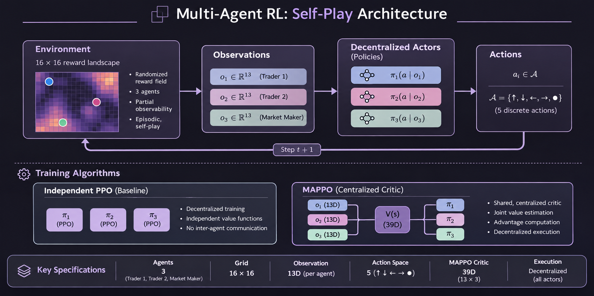
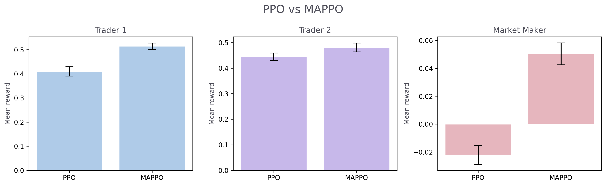
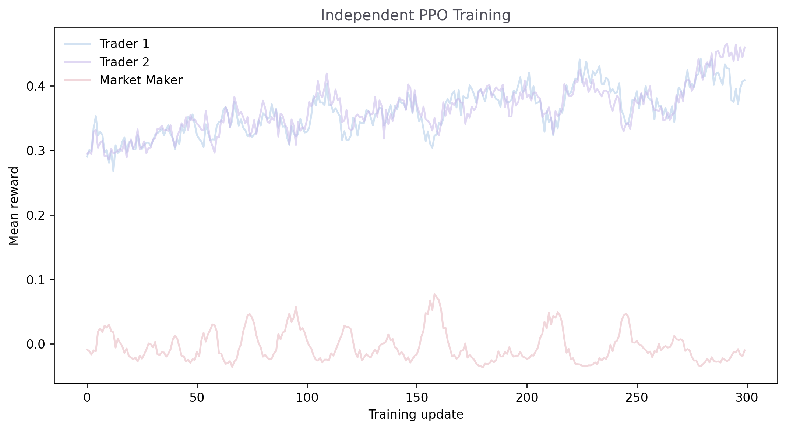
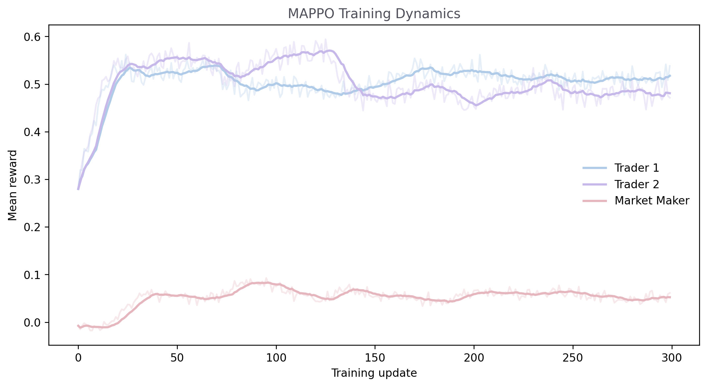
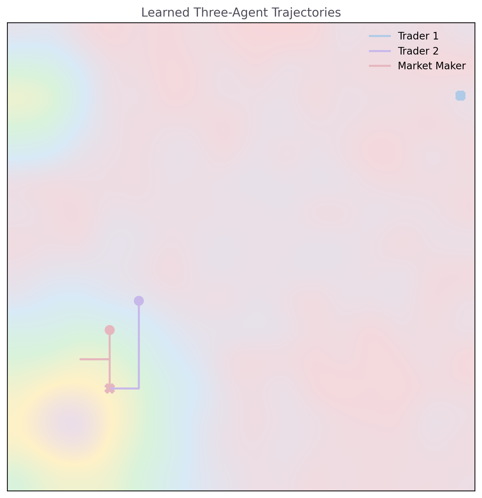
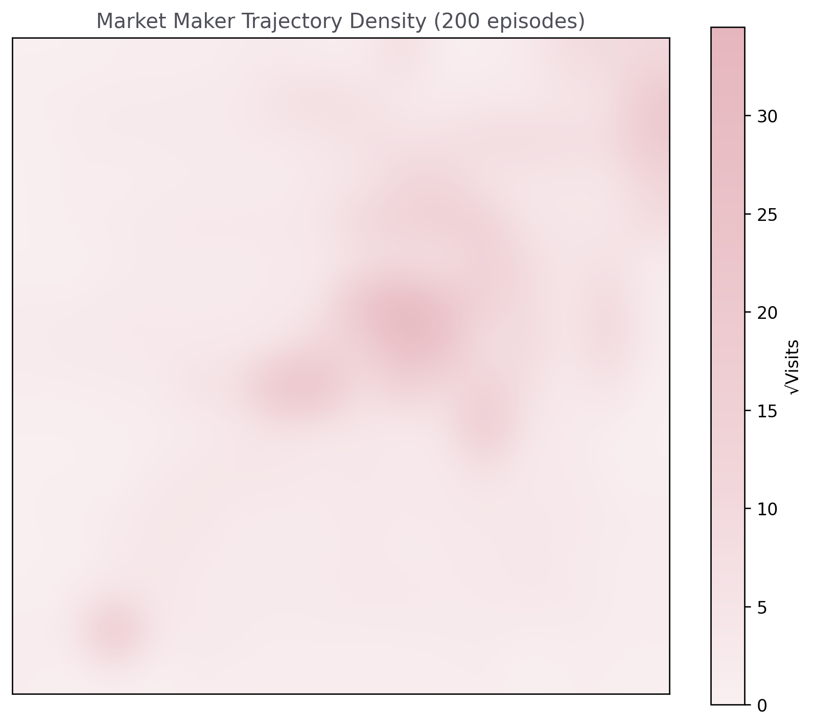
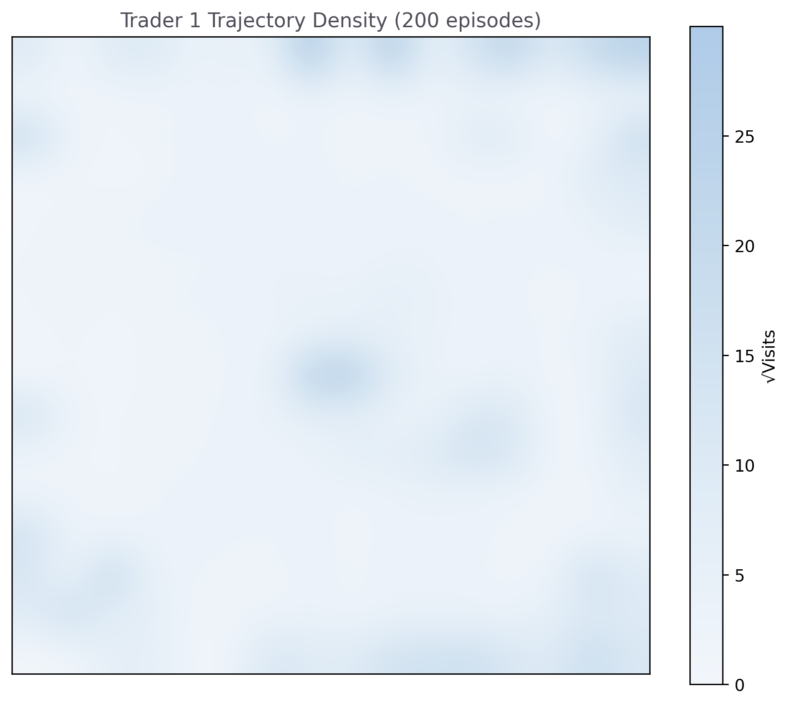
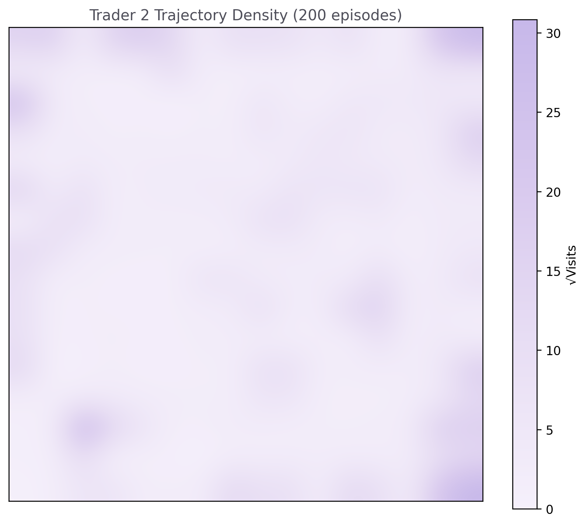

# Self-Play MARL

A lightweight 2v1 partially observable gridworld with two Traders and one Market Maker. All three agents move on randomized reward landscapes, but each only sees a local patch of the terrain and the last position at which it observed an opponent. I use the environment to compare independent PPO against MAPPO with a centralized critic and decentralized execution.



## Environment and observations

Each episode runs on a randomized $16 \times 16$ reward landscape. The landscape is sampled from five terrain patterns, normalized, and blended with uniform noise:

$$
R_{\text{map}}(x,y)
=
\operatorname{Norm}\left((1-\delta)Z(x,y)+\delta\,\epsilon(x,y)\right),
\qquad \epsilon \sim \mathcal{U}(0,1).
$$

An agent does not receive the full map. Its observation combines its normalized position, a $3 \times 3$ local terrain patch, and the normalized last-seen position of its opponent:

$$
o_i^t =
\left[
\frac{p_i^t}{15},
\; \operatorname{Patch}_{3\times3}(Z,p_i^t),
\; \frac{\ell_i^t}{15}
\right]
\in \mathbb{R}^{13}.
$$

Here, $p_i^t$ is the agent's current grid position and $\ell_i^t$ is its last-seen opponent position. The patch contributes 9 values, while the two positions contribute 2 each.

All agents share the same five-action space:

$$
\mathcal{A}=\{\uparrow,\downarrow,\leftarrow,\rightarrow,\text{stay}\}.
$$

Trader rewards are the reward-landscape value at the new position minus a step cost of $0.05$. A successful capture gives the Market Maker $+10$ and the caught Trader $-10$. Episodes terminate when the Market Maker catches either Trader.

## Learning setup

Each agent has its own actor network. Given its local observation, the actor produces a categorical distribution over the five actions:

$$
\pi_i(a\mid o_i)=\operatorname{softmax}(f_i(o_i)).
$$

The PPO baseline trains the three agents independently, with a separate value estimate for each agent. MAPPO keeps the actors decentralized but concatenates their observations for a shared critic:

$$
s^t=[o_1^t,o_2^t,o_3^t]\in\mathbb{R}^{39},
\qquad
V_\phi(s^t)\in\mathbb{R}^{3}.
$$

The critic returns one value estimate per agent. During execution, each actor still selects actions from its own 13D observation. The centralized critic is used for training, not for choosing actions.

Both implementations use generalized advantage estimation. With discount factor $\gamma=0.99$ and GAE parameter $\lambda=0.95$:

$$
\begin{aligned}
\delta_t^i &= r_t^i+\gamma(1-d_t)V_i(s_{t+1})-V_i(s_t),\\
\hat A_t^i &= \delta_t^i+\gamma\lambda(1-d_t)\hat A_{t+1}^i.
\end{aligned}
$$

The PPO policy update uses the clipped probability ratio:

$$
L_{\text{clip}}^i
=
-\mathbb{E}_t\left[
\min\left(
\rho_t^i\hat A_t^i,
\operatorname{clip}(\rho_t^i,1-\eta,1+\eta)\hat A_t^i
\right)
\right],
\quad
\rho_t^i=
\frac{\pi_i(a_t^i\mid o_t^i)}
{\pi_{i,\text{old}}(a_t^i\mid o_t^i)}.
$$

The implementation uses $\eta=0.2$, an entropy coefficient of (0.01), and a value-loss coefficient of (0.5).

## Results

The table below reports the final mean rewards from the saved PPO/MAPPO comparison:

| Agent | Independent PPO | MAPPO |
|:--|--:|--:|
| Trader 1 | 0.410 | 0.515 |
| Trader 2 | 0.445 | 0.481 |
| Market Maker | -0.022 | 0.050 |

MAPPO improves the reported mean reward for all three agents in this comparison. The difference between the two Traders is also worth looking at: despite sharing the same architecture and training procedure, they do not end up with symmetric outcomes. I have not established whether that gap comes from specialization or seed and checkpoint variance, so I would not call it emergent specialization yet.



The training curves show how the three agents evolve under each learning setup.

| Independent PPO | MAPPO |
|:--:|:--:|
|  |  |

The trajectories and visitation densities provide a spatial view of the learned behaviour.



| Market Maker | Trader 1 | Trader 2 |
|:--:|:--:|:--:|
|  |  |  |

### Robustness to landscape distortion

I also evaluated both methods on landscapes with increasing noise, controlled by the distortion parameter $\delta$. This blends the sampled training landscape with uniform noise and tests how the learned policies behave under landscape shift.

| Distortion | PPO T1 | PPO T2 | PPO MM | MAPPO T1 | MAPPO T2 | MAPPO MM |
|---:|---:|---:|---:|---:|---:|---:|
| 0.0 | 0.152 | 0.416 | 0.139 | 0.328 | -0.351 | 1.015 |
| 0.8 | 0.228 | 0.481 | 0.169 | 0.549 | 0.365 | 0.256 |

The Market Maker's MAPPO advantage is strongest near the training distribution, where its mean reward is about 1.0 and capture rate is about 24%. At distortion 0.8, these fall to about 0.26 and 15%. The Trader rewards move in the opposite direction over the same range. Independent PPO is comparatively stable across the distortion sweep.

The full results are in `results/ppo_distortion.csv` and `results/mappo_distortion.csv`.

## Repository layout

```text
.
├── README.md
├── architecture.png
├── requirements.txt
├── LICENSE
├── src/
│   ├── config.py
│   ├── environment.py
│   ├── agents.py
│   ├── training.py
│   ├── evaluation.py
│   └── visualization.py
├── assets/
│   ├── agent_trajectories.png
│   ├── mappo_training.png
│   ├── market_maker_density.png
│   ├── ppo_training.png
│   ├── ppo_vs_mappo.png
│   ├── reward_landscapes.png
│   ├── terrain_trajectory.png
│   ├── trader_1_density.png
│   └── trader_2_density.png
└── results/
    ├── ppo_mappo_final.csv
    ├── ppo_training_history.csv
    ├── mappo_training_history.csv
    ├── ppo_distortion.csv
    ├── mappo_distortion.csv
    ├── observation_spec.csv
    ├── ppo_history.npy
    ├── mappo_history.npy
    ├── mappo_losses.npy
    ├── trader1_density.npy
    ├── trader2_density.npy
    └── market_maker_density.npy
```

The main implementation lives in `src/`: `environment.py` defines the landscapes, observations, movement, rewards, capture, and last-seen memory; `agents.py` contains the actor networks and centralized critic; and `training.py` implements rollouts, GAE, PPO, and MAPPO updates. Evaluation and plotting are handled by `evaluation.py` and `visualization.py`.

## Run

```bash
pip install -r requirements.txt
python run.py
```

For a smaller smoke run:

```bash
python run.py --steps 10 --batch 64 --horizon 32
```

Outputs are written to `results/`.
